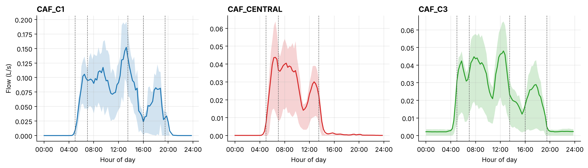
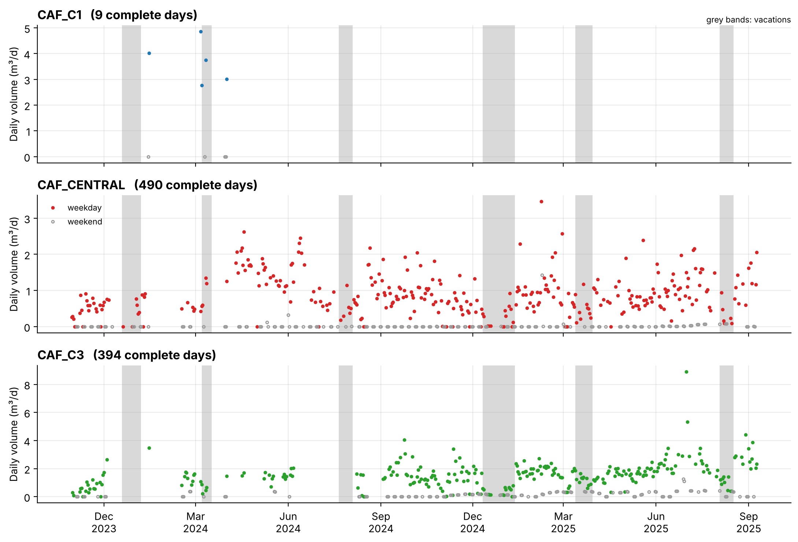

# Water demand of three university cafeterias: exploratory analysis

Exploratory data analysis (EDA) of smart water meter data from three cafeterias of the
Víctor Levi Sasso campus of the Universidad Tecnológica de Panamá (UTP), October 2023 to
September 2025.

The meters record the cumulative volume delivered to each cafeteria. The notebooks describe the
quality of the raw readings, derive consumption at 15-min resolution without filling gaps, and
explore the hourly, daily, weekly and seasonal patterns of demand, the differences between
cafeterias, and the night-time and off-hours use.

| Cafeteria | Service | Readings | Period |
|---|---|---|---|
| `CAF_C1` | breakfast, lunch, dinner | 4,216 | Oct 2023 – Jun 2025 (very sparse) |
| `CAF_CENTRAL` | breakfast, lunch | 49,024 | Oct 2023 – Sep 2025 |
| `CAF_C3` | breakfast, lunch, dinner | 40,887 | Oct 2023 – Sep 2025 |

## Main findings



* **Data quality.** `CAF_CENTRAL` and `CAF_C3` report every 15 min most of the time, and a
  valid consumption value is available for 89 % and 77 % of their 15-min intervals. `CAF_C1`
  is very sparse (valid data for 9 % of the period, 60 gaps longer than one day), so its
  results are indicative only.
* **Daily patterns.** `CAF_CENTRAL` is breakfast-oriented (peak at 06:00, almost no use after
  14:00). `CAF_C1` and `CAF_C3` show three peaks: morning, lunch (12:00–13:00) and dinner
  (17:00–18:00). Morning service accounts for 53–71 % of the daily volume.
* **Weekly and academic cycles.** Weekend use is a small fraction of weekday use, and during
  vacations the weekday flow falls to about 40 % of its level during classes.
* **Base flow.** `CAF_C3` has a continuous night flow (≈ 0.003 L/s, about 60 L per night) on
  94 % of the nights, which deserves an on-site check. The other two cafeterias drop to zero at
  night.
* **Calendar.** Days with zero use that the national holiday calendar misses (Carnival, Holy
  Thursday, the Panama City holiday of 15 August) are visible in the data.



## Repository structure

```
data/                     corrected meter readings (one CSV per cafeteria) and data dictionary
src/eda_utils.py          shared functions: loading, consumption, calendar labels, figures
notebooks/
  01_data_quality.ipynb            readings, sampling interval, gaps, daily coverage
  02_preprocessing.ipynb           consumption at 15 min without filling gaps, labels
  03_temporal_patterns.ipynb       daily, weekly, monthly and hourly demand
  04_cafeteria_comparison.ipynb    correlation and normalised profiles between cafeterias
  05_operational_segmentation.ipynb  operating periods, base flow, off-hours use
figures/                  figures produced by the notebooks
```

The notebooks are saved with their outputs, so they can be read directly on GitHub.

## Method in brief

1. Timestamps exported in UTC were shifted to local time (UTC−5).
2. The cumulative volume is interpolated linearly at every 15-min boundary, **only when the
   boundary lies between two readings at most 60 min apart**. Consumption of an interval is the
   difference of the volume at its two boundaries; intervals touching a longer gap are left
   empty instead of receiving an invented, evenly spread consumption (notebook 2).
3. Each interval is labelled with Panama's public holidays, the academic period (classes or
   vacation) and the operating period of the cafeteria.
4. Means are computed over valid intervals; daily totals use only complete days.

## How to run

```bash
python -m venv .venv
source .venv/bin/activate        # Windows: .venv\Scripts\activate
pip install -r requirements.txt
jupyter lab notebooks/
```

Run the notebooks in order; each one rebuilds what it needs from `data/` and writes its
figures to `figures/`.

## License

Code: [MIT](LICENSE). Data and figures: [CC BY 4.0](LICENSE-DATA.md).
